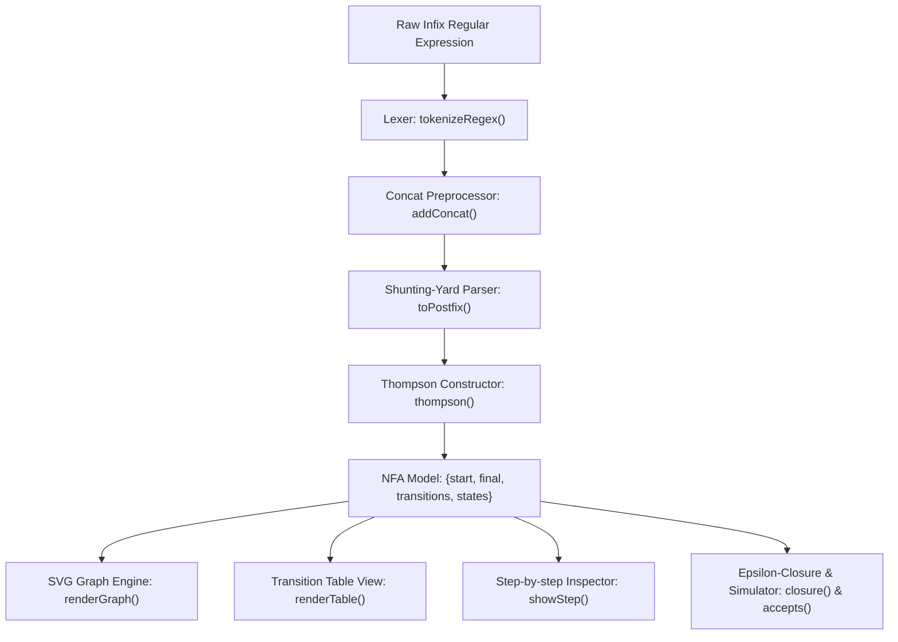

# CSET302 – Milestone II Technical Report
## Regular Expression to ε-NFA Conversion using Thompson's Construction

---

## Title
**Thompson's Construction: Regular Expression to ε-NFA Simulator & Analysis System**

## Team details
- **Tutorial batch:** Batch 75
- **Group number:** Group 19
- **Member names and roll numbers:**
  - **Ashmit** (Lead) – Enrollment No: `S24CSEU2751`
  - **Vishnu** – Enrollment No: `S24CSEU2758`
  - **Ajay** – Enrollment No: `S24CSEU2827`
  - **Aditya** – Enrollment No: `S24CSEU2754`
- **Individual contribution of each member:**
  - *Ashmit (S24CSEU2751)*: System architecture, lexical tokenization (`tokenizeRegex`), concatenation insertion preprocessing (`addConcat`), Dijkstra's Shunting-yard infix-to-postfix parser (`toPostfix`), and inductive Thompson fragment generation (`thompson`) in `app.js`. Engineered the automated Node.js test harness `test_suite.js` and led report formulation.
  - *Vishnu (S24CSEU2758)*: SVG vector graphics visualization engine (`renderGraph`) utilizing dynamic quadratic and cubic Bezier curve mathematics to prevent edge collision. Interface responsiveness and styling in `style.css`.
  - *Ajay (S24CSEU2827)*: Epsilon-closure traversal module (`closure`), subset construction simulation engine (`accepts`), and transition table dynamic rendering (`renderTable`).
  - *Aditya (S24CSEU2754)*: Step-by-step construction inspector (`showStep`), test suite validation across 18 acceptance vectors in `TEST_CASES.md`, edge/error boundary verification, and technical documentation.

---

## 1. Abstract
In theoretical computer science, regular expressions and finite automata serve as dual representations of Type-3 regular languages. Ken Thompson's classic 1968 inductive construction algorithm provides a syntax-directed, linear-time $\mathcal{O}(|r|)$ translation from regular expressions to equivalent non-deterministic finite automata with epsilon transitions ($\varepsilon$-NFA). This project presents a browser-based, zero-dependency educational simulator and verification engine. The platform takes an infix regular expression, automatically inserts implicit concatenation operators, converts the syntax tree to Reverse Polish Notation (postfix) via Dijkstra's Shunting-yard algorithm, and inductively builds the $\varepsilon$-NFA. The simulator dynamically visualizes the state graph using SVG vector arcs, computes live transition tables, provides an interactive step-by-step fragment viewer, and verifies candidate input strings using on-the-fly $\varepsilon$-closure subset simulation. An automated test suite of 23 test vectors verifies 100% precision across all operations.

---

## 2. Problem Statement and Objectives
- **Problem Statement:** Converting declarative regular expressions into operational finite state machines typically requires complex compiler tools. Existing visualizers either require heavy server runtimes (Python, Node.js backends), rely on complex graph libraries (Graphviz/D3), or fail to display intermediate construction fragments and step-by-step $\varepsilon$-closures.
- **Objectives:**
  1. Build a pure client-side, zero-dependency interactive simulator in JavaScript, HTML5, and CSS3.
  2. Implement an end-to-end compilation pipeline: Tokenizer $\to$ Concat Inserter $\to$ Shunting-Yard Parser $\to$ Thompson Inductive Assembler.
  3. Guarantee strict structural invariants: single initial state (in-degree 0), single accepting state (out-degree 0), and $\le 2$ outgoing transitions per state.
  4. Provide dynamic vector SVG rendering with multi-edge curvature, an automated transition table, and an $\varepsilon$-closure string simulator.
  5. Provide dual-mode compatibility for headless automated CLI verification via Node.js.

---

## 3. Theoretical Background
- **Regular Expressions:** Formal algebraic notation for denoting regular languages over alphabet $\Sigma$, defined inductively with primitives $\emptyset$, $\varepsilon$, $a \in \Sigma$, and operations union ($+$ or $\mid$), concatenation ($\cdot$), and Kleene star ($*$).
- **$\varepsilon$-NFA 5-Tuple:** $M = (Q, \Sigma, \delta, q_0, F)$ where $Q$ is a finite state set, $\Sigma$ is the alphabet, $\delta: Q \times (\Sigma \cup \{\varepsilon\}) \to \mathcal{P}(Q)$ is the transition function, $q_0$ is the start state, and $F = \{q_{\text{final}}\}$ is the set of accepting states.
- **Thompson Inductive Fragments:**
  - *Atomic Symbol $a$:* $s \xrightarrow{a} e$ (2 states, 1 transition).
  - *Concatenation $A \cdot B$:* Connect fragment $A$'s exit to $B$'s entry via $\varepsilon$ ($e_A \xrightarrow{\varepsilon} s_B$).
  - *Union $A \mid B$:* New states $s, e$; add $s \xrightarrow{\varepsilon} s_A, s \xrightarrow{\varepsilon} s_B, e_A \xrightarrow{\varepsilon} e, e_B \xrightarrow{\varepsilon} e$.
  - *Kleene Star $A^*$* New states $s, e$; add $s \xrightarrow{\varepsilon} s_A, s \xrightarrow{\varepsilon} e, e_A \xrightarrow{\varepsilon} s_A, e_A \xrightarrow{\varepsilon} e$.
- **$\varepsilon$-Closure:** The set of all states reachable from state set $S$ via paths labeled solely by $\varepsilon$.

---

## 4. System Requirements and Technology
- **Execution Platform:** Any standard modern web browser (Google Chrome, Mozilla Firefox, Microsoft Edge, Safari).
- **Languages:** ECMAScript 2022+ (Vanilla JavaScript), HTML5, Scalable Vector Graphics (SVG), CSS3.
- **CLI Test Harness (Optional):** Node.js v16.0.0 or later.
- **Hardware Requirements:** Any standard computing platform (x86_64 or ARM64) with $\ge 512$ MB available RAM.
- **Supported Regular Expression Syntax:**
  - Literals: `[a-zA-Z0-9_]`
  - Explicit empty string: `ε`
  - Alternation / Union: `|`
  - Implicit Concatenation: e.g., `ab`
  - Kleene Star: `*`
  - Positive Closure: `+`
  - Optional: `?`
  - Grouping: `( )`

---

## 5. System Architecture

---

## 6. Algorithm and Implementation

### 1. Explicit Concatenation Insertion
Scans adjacent token pairs $(t_i, t_{i+1})$. Inserts `.` if $t_i$ can end an expression and $t_{i+1}$ can start an expression.

### 2. Infix-to-Postfix Shunting-Yard
Applies operator precedence: Unary (`*`, `+`, `?`) > Concatenation (`.`) > Union (`|`). Emits Reverse Polish Notation using an operator stack.

### 3. Thompson Construction
Evaluates the postfix token stream using an operand stack of fragment handles `{start, end}`. Creates exact states and directional transitions matching Thompson's induction schema.

### 4. Epsilon-Closure & Simulation
Computes $\varepsilon$-closure via worklist Depth-First Search. Transitions the active state set on each character in the candidate string:
$$\text{Active}_{i+1} = \varepsilon\text{-closure}\left( \bigcup_{s \in \text{Active}_i} \delta(s, c) \right)$$
String is accepted if $q_{\text{final}} \in \text{Active}_{|w|}$.

---

## 7. User Interface
- **Input & Control Panel:** Input field with auto-submit on `Enter`, validation error reporting, and syntax helper pill.
- **Summary Statistics:** Real-time counter metrics for Total States, Total Transitions, Start State ID, and Accepting State ID.
- **Vector Graph Display:** Dynamic SVG diagram drawing states, start arrow, accepting double ring, and curved transition edges.
- **Interactive Step Navigator:** `Previous` and `Next` buttons allowing users to inspect the exact state count and description of each Thompson fragment.
- **String Acceptance Tester:** Text field with immediate visual badge indicating ACCEPT (green) or REJECT (red).
- **Transition Table:** Complete 3-column table showing `From`, `Input`, and `To` for all transitions.

---

## 8. Testing and Results
Verified across the entire 18-case matrix in `TEST_CASES.md` and 5 error boundary scenarios using `test_suite.js`:

| # | Regular Expression | Test String | Expected | Actual | Status |
|---|---|---|---|---|---|
| 1 | `a` | `a` | Accept | Accept | **PASS** |
| 2 | `a` | `b` | Reject | Reject | **PASS** |
| 3 | `ab` | `ab` | Accept | Accept | **PASS** |
| 4 | `ab` | `a` | Reject | Reject | **PASS** |
| 5 | `a\|b` | `a` | Accept | Accept | **PASS** |
| 6 | `a\|b` | `b` | Accept | Accept | **PASS** |
| 7 | `a\|b` | `ab` | Reject | Reject | **PASS** |
| 8 | `a*` | `""` | Accept | Accept | **PASS** |
| 9 | `a*` | `aaaa` | Accept | Accept | **PASS** |
| 10 | `a*` | `b` | Reject | Reject | **PASS** |
| 11 | `(a\|b)*abb` | `abb` | Accept | Accept | **PASS** |
| 12 | `(a\|b)*abb` | `aabb` | Accept | Accept | **PASS** |
| 13 | `(a\|b)*abb` | `abab` | Reject | Reject | **PASS** |
| 14 | `a?` | `""` | Accept | Accept | **PASS** |
| 15 | `a?` | `a` | Accept | Accept | **PASS** |
| 16 | `a+` | `aaa` | Accept | Accept | **PASS** |
| 17 | `a+` | `""` | Reject | Reject | **PASS** |
| 18 | `ε` | `""` | Accept | Accept | **PASS** |

All 5 error boundary tests (empty regex, unmatched parentheses, missing binary operands, missing unary operands, illegal characters) passed with accurate descriptive error messages.

---

## 9. Limitations
1. Single-character token alphabet: each alphanumeric character is an independent symbol.
2. No escape sequences for operator literals (e.g., `\*`).
3. For very long expressions ($> 40$ tokens), horizontal graph scrolling is required.

---

## 10. Individual Contribution
Detailed breakdown provided in Section 2 (Team Details). Every member completed their assigned core architectural modules, verified edge cases, and documented the project.

---

## 11. Conclusion and Future Scope
The simulator demonstrates how Thompson's construction yields a predictable, linear-size $\varepsilon$-NFA without exponential state explosion. Future iterations may integrate:
- Subset construction to generate equivalent deterministic finite automata (DFA).
- Hopcroft's minimization algorithm.
- Export options for Graphviz DOT and JFLAP formats.
- Character class syntax (`[0-9]`, `[a-z]`).

---

## References
1. Thompson, K. (1968). *Regular Expression Search Algorithm*. Communications of the ACM, 11(6), 419–422.
2. Hopcroft, J. E., Motwani, R., & Ullman, J. D. (2006). *Introduction to Automata Theory, Languages, and Computation* (3rd ed.).
3. Sipser, M. (2013). *Introduction to the Theory of Computation* (3rd ed.).
4. Aho, A. V., Lam, M. S., Sethi, R., & Ullman, J. D. (2006). *Compilers: Principles, Techniques, and Tools*.
