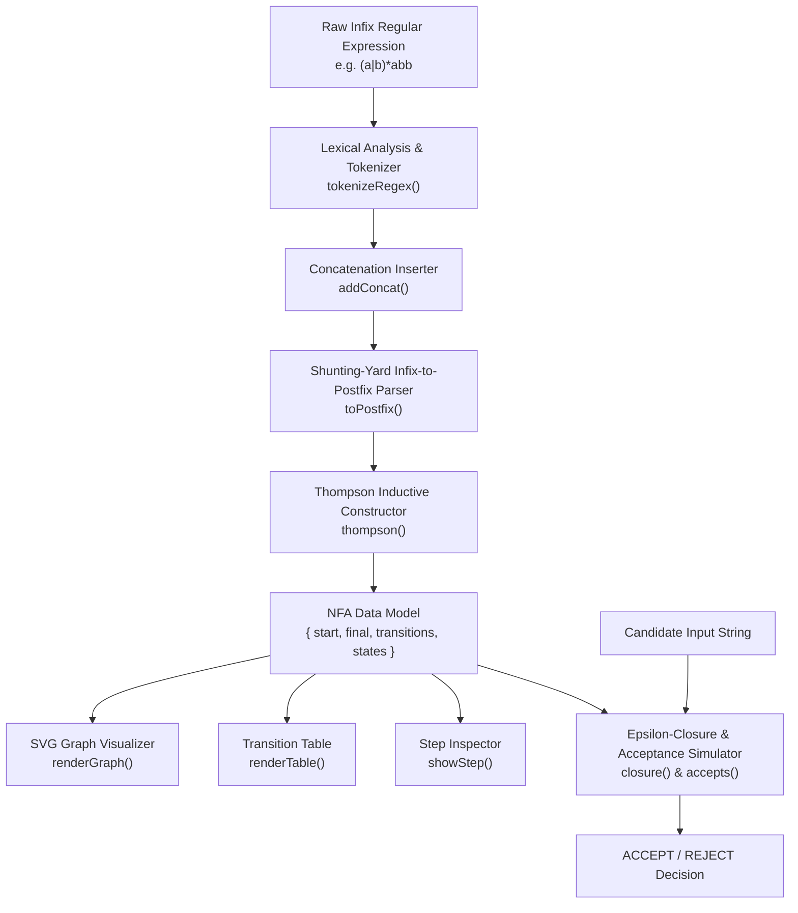

# Thompson's Construction: Regular Expression to ε-NFA Simulator

A modular, browser-based educational simulator and computational engine developed for **CSET302: Automata Theory & Computability**. It translates regular expressions into equivalent non-deterministic finite automata with epsilon transitions ($\varepsilon$-NFA) using Ken Thompson's inductive fragment construction algorithm.

---

## Table of Contents
- [Project Overview](#project-overview)
- [Key Features](#key-features)
- [Supported Grammar & Syntax](#supported-grammar--syntax)
- [System Architecture](#system-architecture)
- [Installation and Execution](#installation-and-execution)
- [Automated Testing & Test Suite](#automated-testing--test-suite)
- [Repository Structure](#repository-structure)
- [Algorithmic Workflow](#algorithmic-workflow)
- [Documentation & Reports](#documentation--reports)
- [License & Academic Credits](#license--academic-credits)

---

## Project Overview

In formal language theory, regular expressions and finite automata are computationally equivalent representations of Type-3 languages in the Chomsky hierarchy. While regular expressions offer declarative pattern descriptions, finite state automata provide operational execution models.

This simulator bridges the theoretical gap by implementing an interactive, client-side, zero-dependency engine that:
1. Tokenizes and validates infix regular expressions.
2. Automatically infers and inserts implicit concatenation operators (`.`).
3. Converts the infix expression into postfix notation (Reverse Polish Notation) via Dijkstra's Shunting-yard algorithm.
4. Inductively synthesizes an $\varepsilon$-NFA using Ken Thompson's fragment construction technique.
5. Computes $\varepsilon$-closures to simulate string acceptance and state reachability on-the-fly.
6. Dynamically renders the state graph as an interactive vector SVG along with a complete state transition table.

---

## Key Features

- **Pure Zero-Dependency Stack**: Built purely using native HTML5, modern vanilla JavaScript (ES6+), and CSS3. Requires no external packages, compilers, build pipelines, or cloud backends.
- **Visual Thompson Fragment Decomposition**: Displays step-by-step structural snapshots illustrating how each sub-automaton is synthesized.
- **Dynamic Curved Vector SVG Graph**: Automatically plots states along a horizontal topological coordinate system with quadratic Bezier curves for inter-state transitions and cubic loops for self-transitions.
- **Live Transition Table**: Tabulates all triples $(q_{\text{from}}, \sigma, q_{\text{to}})$ dynamically.
- **Interactive String Simulator**: Computes $\varepsilon$-closure sets dynamically over candidate input strings and delivers instantaneous ACCEPT / REJECT decisions.
- **Dual Execution Environment**: Functions seamlessly in modern web browsers and exports CommonJS modules for headless automated CLI testing in Node.js.

---

## Supported Grammar & Syntax

| Syntax Element | Symbol / Notation | Description | Example |
| :--- | :--- | :--- | :--- |
| **Alphanumerics** | `a-z`, `A-Z`, `0-9`, `_` | Atomic alphabet literals | `a`, `1`, `x_0` |
| **Epsilon Symbol** | `ε` | Empty string (lambda / null transition) | `ε` |
| **Union** | `\|` | Disjunction / alternation between two expressions | `a\|b` |
| **Concatenation** | Implicit / `.` | Sequential juxtaposition of operands | `ab` (treated as `a.b`) |
| **Kleene Star** | `*` | Zero or more repetitions (closure) | `a*`, `(a\|b)*` |
| **Positive Closure**| `+` | One or more repetitions | `a+` (equivalent to `aa*`) |
| **Optional** | `?` | Zero or one instance | `a?` (equivalent to `a\|ε`) |
| **Parentheses** | `( )` | Precedence grouping | `(a\|b)c` |

*Note: Operands must be single-character alphanumeric tokens or `ε`. Escape characters (e.g. `\*`) are reserved for future releases.*

---

## System Architecture



---

## Installation and Execution

### Prerequisites
- Any modern web browser (Google Chrome, Mozilla Firefox, Microsoft Edge, Safari, Brave).
- *(Optional for automated testing)*: Node.js (v16.0.0 or higher).

### Method 1: Graphical Browser Interface (Recommended)
1. Clone or extract the repository folder:
   ```bash
   cd c:\Users\ASHMIT\Desktop\thompson_nfa_simulator
   ```
2. Open `index.html` directly in your browser:
   - **Double-click**: Double-click `index.html` in your file explorer.
   - **VS Code Live Server**: Right-click `index.html` inside VS Code and choose **Open with Live Server**.
   - **Command Line**:
     - *Windows (PowerShell)*: `Start-Process index.html`
     - *macOS*: `open index.html`
     - *Linux*: `xdg-open index.html`
3. Enter any regular expression in the input box and click **Build ε-NFA**.
4. Test candidate strings in the **Test a string** panel.

---

## Automated Testing & Test Suite

The repository contains an automated test harness (`test_suite.js`) executing 18 algorithmic acceptance tests and 5 syntax error boundary tests.

### Running the CLI Test Suite
Execute the test runner via Node.js:
```bash
node test_suite.js
```

### Expected Output
```text
========================================================================
       RUNNING AUTOMATED TEST SUITE: THOMPSON NFA SIMULATOR            
========================================================================

[PASS] Case #01: RE="a" String="a" -> ACCEPT (Single literal exact match)
[PASS] Case #02: RE="a" String="b" -> REJECT (Single literal mismatch)
[PASS] Case #03: RE="ab" String="ab" -> ACCEPT (Simple concatenation match)
[PASS] Case #04: RE="ab" String="a" -> REJECT (Incomplete concatenation)
[PASS] Case #05: RE="a|b" String="a" -> ACCEPT (Union left branch match)
[PASS] Case #06: RE="a|b" String="b" -> ACCEPT (Union right branch match)
[PASS] Case #07: RE="a|b" String="ab" -> REJECT (Union rejection of sequence)
[PASS] Case #08: RE="a*" String="" -> ACCEPT (Kleene star zero repetitions (empty string))
[PASS] Case #09: RE="a*" String="aaaa" -> ACCEPT (Kleene star multiple repetitions)
[PASS] Case #10: RE="a*" String="b" -> REJECT (Kleene star mismatch)
[PASS] Case #11: RE="(a|b)*abb" String="abb" -> ACCEPT (Standard textbook regex minimal match)
[PASS] Case #12: RE="(a|b)*abb" String="aabb" -> ACCEPT (Standard textbook regex prefix match)
[PASS] Case #13: RE="(a|b)*abb" String="abab" -> REJECT (Standard textbook regex negative test)
[PASS] Case #14: RE="a?" String="" -> ACCEPT (Optional operator zero instances)
[PASS] Case #15: RE="a?" String="a" -> ACCEPT (Optional operator one instance)
[PASS] Case #16: RE="a+" String="aaa" -> ACCEPT (Positive closure multiple repetitions)
[PASS] Case #17: RE="a+" String="" -> REJECT (Positive closure zero repetitions rejection)
[PASS] Case #18: RE="ε" String="" -> ACCEPT (Explicit epsilon match with empty string)

--- ERROR BOUNDARY VALIDATION ---
[PASS] Error Case E1: Properly caught "Enter a regular expression first."
[PASS] Error Case E2: Properly caught "Mismatched parentheses."
[PASS] Error Case E3: Properly caught "Union needs two operands."
[PASS] Error Case E4: Properly caught "Operator * has no operand."
[PASS] Error Case E5: Properly caught "Unsupported character "#" at position 2."

========================================================================
TEST SUMMARY: 23 Passed, 0 Failed, Total: 23
========================================================================
```

---

## Repository Structure

```text
thompson_nfa_simulator/
├── index.html                    # Presentation skeleton, responsive layout & SVG canvas
├── style.css                     # Premium typography, color systems & flex/grid layout
├── app.js                        # Core computational engine & UI controller (JSDoc documented)
├── test_suite.js                 # Headless Node.js automated test runner (23 test vectors)
├── TEST_CASES.md                 # Test plan specification matrix and evaluation guidelines
├── SOURCE_CODE_DOCUMENTATION.md  # Exhaustive source code documentation & module reference
├── TECHNICAL_PROJECT_REPORT.md   # Complete academic technical report for Milestone II
├── M2_REPORT_TEMPLATE.md         # Course milestone template outline
└── README.md                     # Comprehensive project readme & quick-start manual
```

---

## Algorithmic Workflow

### 1. Infix Preprocessing
In standard regular expressions, concatenation is implicit (`ab` means $a \cdot b$). The preprocessor inspects adjacent token pairs $(t_i, t_{i+1})$ and injects explicit `.` operators if $t_i \in \{\text{literal}, ), *, +, ?\}$ and $t_{i+1} \in \{\text{literal}, (, \varepsilon\}$.

### 2. Shunting-Yard Infix to Postfix
Using Dijkstra's Shunting-yard algorithm, tokens are processed using an operator stack with explicit operator precedence:
$$\text{Precedence: } (*, +, ?) > (.) > (|)$$
This produces a Reverse Polish Notation stream where operators immediately succeed their operands.

### 3. Thompson Inductive Fragment Synthesis
Thompson's algorithm evaluates the postfix stream using a stack of NFA fragments, where each fragment possesses:
- Exactly one entry state $q_{\text{start}}$.
- Exactly one exit state $q_{\text{final}}$.
- At most two outgoing transitions per state.

### 4. Subset Simulation via $\varepsilon$-Closure
Given a state subset $S \subseteq Q$, $\varepsilon\text{-closure}(S)$ performs a Breadth-First / Depth-First search along all directed edges labeled $\varepsilon$. For every input symbol $c$, the active configuration transitions according to:
$$S' = \varepsilon\text{-closure}\left( \bigcup_{s \in S} \delta(s, c) \right)$$
The string is accepted if and only if $q_{\text{final}} \in S_{|w|}$.

---

## Documentation & Reports

Detailed technical documentation and submission reports are provided in the repository:
- **[Source Code Documentation](SOURCE_CODE_DOCUMENTATION.md)**: In-depth function prototypes, parameter specifications, asymptotic complexity analysis, and invariant verification.
- **[Technical Project Report](TECHNICAL_PROJECT_REPORT.md)**: Formal academic report following institutional guidelines, including theoretical background, formal definitions, experimental test results, and future scope.

---

## License & Academic Credits
Developed for **CSET302: Automata Theory & Computability**.
Intended for academic, instructional, and research exploration of compiler front-end techniques and automata theory.
