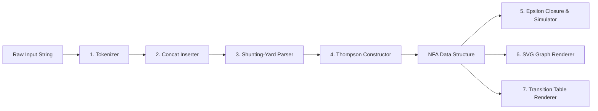

# Source Code Documentation: Thompson's Construction ε-NFA Simulator

**Course:** CSET302 – Automata Theory & Computability  
**Project:** Regular Expression to ε-NFA Conversion and Simulation Engine  
**Language:** JavaScript (ECMAScript 2022+ / HTML5 / SVG / CSS3)  
**Execution Environments:** Modern Web Browsers (Chrome, Firefox, Safari, Edge) & Node.js (v16+)

---

## 1. Architectural Overview and Module Structure

The application follows a clean separation of concerns, dividing theoretical automata construction from user-interface presentation. The core logic in `app.js` operates as a multi-stage compilation and execution pipeline:



### File Manifest
1. **`index.html`**: Semantic markup defining the application header, panels for input, statistical summary badges, dynamic SVG viewport, construction step navigator, string tester, and transition table.
2. **`style.css`**: Styling implementing responsive layout, CSS grid metrics, color tokens, and graph container scroll styling.
3. **`app.js`**: Primary source file containing the complete computational engine and browser presentation controller.
4. **`test_suite.js`**: Standalone automated Node.js test suite with 23 validation vectors covering all operators and error boundaries.

---

## 2. Core Data Structures

### 2.1 Transition Edge Object
Represents a directed labeled transition in the $\varepsilon$-NFA:
```typescript
interface Transition {
  from: string;    // Source state identifier, e.g., 'q0'
  symbol: string;  // Transition symbol: alphanumeric character or 'ε'
  to: string;      // Destination state identifier, e.g., 'q1'
}
```

### 2.2 Automaton Fragment (Thompson Sub-Automaton)
During inductive synthesis, intermediate sub-automata are maintained on the evaluation stack:
```typescript
interface Fragment {
  start: string;   // Unique entry state ID (in-degree = 0 within fragment)
  end: string;     // Unique exit state ID (out-degree = 0 within fragment)
}
```

### 2.3 Complete NFA Representation
The final automaton emitted by the Thompson construction function:
```typescript
interface NFA {
  start: string;            // Initial state of the full NFA
  final: string;            // Sole accepting/final state
  transitions: Transition[]; // Complete list of directed transitions
  states: string[];         // Exhaustive list of state IDs ['q0', 'q1', ...]
}
```

### 2.4 Construction Step Snapshot
Used by the UI step inspector to provide an interactive educational walkthrough of fragment creation:
```typescript
interface StepSnapshot {
  title: string;       // Descriptive operation title (e.g., 'Apply Kleene star (*)')
  detail: string;      // Theoretical explanation of the state wiring
  states: number;      // Total state count at this point in construction
  transitions: number; // Total transition count at this point in construction
}
```

---

## 3. Function-by-Function Reference (`app.js`)

### 3.1 Lexical Analysis: `tokenizeRegex(s)`
- **Signature:** `tokenizeRegex(s: string): string[]`
- **Purpose:** Converts the raw input string into validated individual tokens.
- **Parameters:**
  - `s`: The input regular expression string.
- **Returns:** An array of token strings.
- **Exceptions:**
  - Throws `Error("Enter a regular expression first.")` if input has no valid tokens.
  - Throws `Error("Unsupported character '<c>' at position <i>.")` if an illegal character is encountered.
- **Allowed Tokens:**
  - Literals: `[A-Za-z0-9_]`
  - Operators: `(`, `)`, `|`, `*`, `+`, `?`
  - Epsilon: `ε`
  - Whitespace is stripped automatically.

---

### 3.2 Concatenation Inserter: `addConcat(tokens)`
- **Signature:** `addConcat(tokens: string[]): string[]`
- **Purpose:** Transforms implicit concatenation into explicit binary `.` operator tokens to facilitate standard infix parsing.
- **Logic:**
  A concatenation operator `.` is inserted between token $t_i$ and token $t_{i+1}$ if and only if:
  1. $t_i$ can legitimately end an operand: $t_i \in \{')', '*', '+', '?'\}$ or $t_i \notin \{'|', '('\}$.
  2. $t_{i+1}$ can legitimately start an operand: $t_{i+1} = '('$ or $t_{i+1} \notin \{'|', ')', '*', '+', '?'\}$.
- **Complexity:** $\mathcal{O}(n)$ time and $\mathcal{O}(n)$ space where $n$ is the number of tokens.

---

### 3.3 Shunting-Yard Infix-to-Postfix Converter: `toPostfix(tokens)`
- **Signature:** `toPostfix(tokens: string[]): string[]`
- **Purpose:** Translates infix tokens with explicit concatenation into Reverse Polish Notation (postfix).
- **Precedence Hierarchy:**
  - Postfix unary operators (`*`, `+`, `?`): Handled immediately upon scanning (highest precedence).
  - Concatenation (`.`): Precedence 2.
  - Union (`|`): Precedence 1.
- **Parameters:**
  - `tokens`: Token array generated by `addConcat()`.
- **Returns:** Postfix token stream ready for stack evaluation.
- **Exceptions:**
  - Throws `Error("Mismatched parentheses.")` on unmatched opening or closing parentheses.

---

### 3.4 Thompson Inductive Constructor: `thompson(postfix)`
- **Signature:** `thompson(postfix: string[]): NFA`
- **Purpose:** Executes Thompson's inductive construction algorithm over the postfix token stream.
- **Internal Mechanics:**
  Maintains a stack of sub-automata fragments.
  - **Literal Symbol / $\varepsilon$**:
    Creates two states $s_{\text{new}}, e_{\text{new}}$ and adds transition $s_{\text{new}} \xrightarrow{\sigma} e_{\text{new}}$. Pushes $\{start: s_{\text{new}}, end: e_{\text{new}}\}$.
  - **Union ($|$)**:
    Pops fragments $B$ and $A$. Creates $s_{\text{new}}, e_{\text{new}}$. Adds $\varepsilon$-transitions:
    $s_{\text{new}} \xrightarrow{\varepsilon} A.start$, $s_{\text{new}} \xrightarrow{\varepsilon} B.start$, $A.end \xrightarrow{\varepsilon} e_{\text{new}}$, $B.end \xrightarrow{\varepsilon} e_{\text{new}}$.
  - **Concatenation ($.$)**:
    Pops fragments $B$ and $A$. Connects $A.end \xrightarrow{\varepsilon} B.start$. Pushes $\{start: A.start, end: B.end\}$.
  - **Kleene Star ($*$)**:
    Pops fragment $A$. Creates $s_{\text{new}}, e_{\text{new}}$. Adds:
    $s_{\text{new}} \xrightarrow{\varepsilon} A.start$, $s_{\text{new}} \xrightarrow{\varepsilon} e_{\text{new}}$, $A.end \xrightarrow{\varepsilon} A.start$, $A.end \xrightarrow{\varepsilon} e_{\text{new}}$.
  - **Positive Closure ($+$)**:
    Pops fragment $A$. Creates $s_{\text{new}}, e_{\text{new}}$. Adds:
    $s_{\text{new}} \xrightarrow{\varepsilon} A.start$, $A.end \xrightarrow{\varepsilon} A.start$, $A.end \xrightarrow{\varepsilon} e_{\text{new}}$.
  - **Optional ($?$)**:
    Pops fragment $A$. Creates $s_{\text{new}}, e_{\text{new}}$. Adds:
    $s_{\text{new}} \xrightarrow{\varepsilon} A.start$, $s_{\text{new}} \xrightarrow{\varepsilon} e_{\text{new}}$, $A.end \xrightarrow{\varepsilon} e_{\text{new}}$.
- **Structural Guarantees:**
  - Single initial state with zero incoming transitions.
  - Single accepting state with zero outgoing transitions.
  - Number of states $\le 2 \times |postfix|$.
  - Number of transitions $\le 4 \times |postfix|$.

---

### 3.5 Epsilon Closure: `closure(states, targetNfa)`
- **Signature:** `closure(states: Iterable<string>, targetNfa?: NFA): Set<string>`
- **Purpose:** Computes the set of all states reachable from `states` via zero or more $\varepsilon$-transitions.
- **Algorithm:**
  Worklist-based Depth-First Search:
  1. Initialize `result = Set(states)` and `todo = Array.from(states)`.
  2. While `todo` is not empty, pop state $s$.
  3. For every transition $s \xrightarrow{\varepsilon} t$ in `targetNfa.transitions`:
     - If $t \notin result$, add $t$ to $result$ and push $t$ onto `todo`.
  4. Return `result`.
- **Complexity:** $\mathcal{O}(|V| + |E_\varepsilon|)$ where $V$ is the set of states and $E_\varepsilon$ is the set of epsilon transitions.

---

### 3.6 String Acceptance Simulation: `accepts(input, targetNfa)`
- **Signature:** `accepts(input: string, targetNfa?: NFA): boolean`
- **Purpose:** Determines whether candidate string `input` is in the language $L(M)$.
- **Algorithm:**
  On-the-fly subset simulation:
  1. Set $S = \text{closure}(\{targetNfa.start\})$.
  2. For each symbol $c$ in `input`:
     - Compute $S_{\text{next}} = \{t \mid \exists s \in S \text{ such that } s \xrightarrow{c} t\}$.
     - Set $S = \text{closure}(S_{\text{next}})$.
  3. Return `true` if $targetNfa.final \in S$, else `false`.
- **Complexity:** $\mathcal{O}(|w| \cdot |E|)$ where $|w|$ is string length and $|E|$ is the total number of transitions.

---

### 3.7 SVG Vector Graph Visualizer: `renderGraph()`
- **Signature:** `renderGraph(): void`
- **Purpose:** Dynamically constructs and injects SVG DOM nodes representing the NFA state diagram.
- **Rendering Techniques:**
  - **Dynamic Viewbox:** Sets SVG canvas width dynamically based on state count ($W = \max(650, |Q| \times 105 + 100)$).
  - **Horizontal Node Placement:** State $q_i$ is placed at coordinate $(75 + i \times 100, 180)$.
  - **Quadratic Bezier Arcs:** Inter-state transitions use quadratic curves $Q((x_1+x_2)/2, y - 48 + \text{offset})$ with alternating vertical offsets to prevent overlapping edges between the same state pair.
  - **Cubic Bezier Loops:** Self-transitions use cubic curves looping smoothly above the state circle.
  - **Accepting State Double Ring:** Final state renders an outer stroke and an inner concentric circle of radius $r=14\text{px}$.

---

### 3.8 Transition Table & Step Controls
- `renderTable()`: Populates the HTML table `#transitionRows` with each transition triple $(q_{\text{from}}, \sigma, q_{\text{to}})$.
- `showStep()`: Renders the current construction snapshot in `#stepText` and updates `#stepCounter`.
- `build()`: Primary controller coordinating input reading, error display resetting, automaton construction, and UI component invocation.

---

## 4. Verification and Automated Testing

### 4.1 CLI Automated Test Runner (`test_suite.js`)
To verify the engine independently of the browser DOM, `test_suite.js` executes directly in Node.js via CommonJS exports.

#### Running Tests:
```bash
node test_suite.js
```

### 4.2 Coverage Matrix
- **Core Operators:** Union (`|`), Concatenation (implicit), Kleene Star (`*`), Positive Closure (`+`), Optional (`?`).
- **Grouping:** Parenthesized subexpressions, nested precedence.
- **Edge Conditions:** Empty input on $\varepsilon$-accepting languages, single-character matches, multi-character repetitions.
- **Error Boundaries:** Empty input, unclosed parentheses, dangling binary operators, leading unary operators, unsupported symbols.
