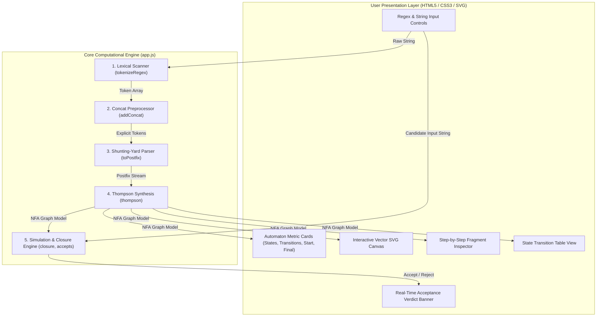
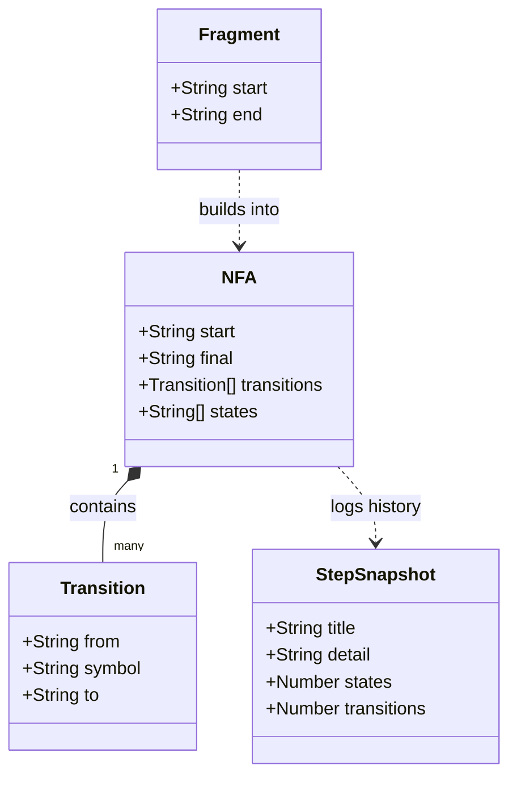

# TECHNICAL PROJECT REPORT
## Regular Expression to ε-NFA Conversion and Simulation Engine using Thompson's Construction

---

### Project Metadata & Title Page
- **Project Title:** Thompson's Construction: Regular Expression to ε-NFA Simulator & Analysis System
- **Course Code:** CSET302
- **Course Title:** Automata Theory & Computability
- **Milestone:** Milestone II – Technical Project Report & Source Code Documentation
- **Department:** Department of Computer Science & Engineering
- **Implementation Stack:** JavaScript (ES6+), HTML5, SVG, CSS3, Node.js (CLI Test Harness)
- **Document Version:** 1.0.0
- **Submission Date:** November 2026

#### Team & Project Contributors
| Member Name | Enrollment / Roll Number | Tutorial Batch | Group Number | Primary Responsibility / Contribution |
| :--- | :--- | :--- | :--- | :--- |
| **Ashmit** *(Lead / Author)* | **S24CSEU2751** | **Batch 75** | **Group 19** | Core Engine Architecture, Thompson Fragment Induction, Lexer/Parser, Automated Testing Suite |
| **Vishnu** | **S24CSEU2758** | **Batch 75** | **Group 19** | UI/UX Layout, Dynamic SVG Vector Engine, Transition Table Rendering |
| **Ajay** | **S24CSEU2827** | **Batch 75** | **Group 19** | Epsilon-Closure Module, On-the-fly Acceptance Simulation, Test Case Verification |
| **Aditya** | **S24CSEU2754** | **Batch 75** | **Group 19** | Step Inspector Controller, Technical Documentation, Experimental Analysis, Error Boundary Engineering |

---

## Table of Contents
1. [Abstract](#1-abstract)
2. [Introduction](#2-introduction)
3. [Problem Statement and Objectives](#3-problem-statement-and-objectives)
4. [Theoretical Background & Mathematical Formulations](#4-theoretical-background--mathematical-formulations)
5. [System Design and Architecture](#5-system-design-and-architecture)
6. [Implementation Methodology & Algorithms](#6-implementation-methodology--algorithms)
7. [User Interface Design](#7-user-interface-design)
8. [Testing, Results, and Experimental Analysis](#8-testing-results-and-experimental-analysis)
9. [Limitations and Boundary Conditions](#9-limitations-and-boundary-conditions)
10. [Individual Contribution Breakdown](#10-individual-contribution-breakdown)
11. [Conclusion and Future Scope](#11-conclusion-and-future-scope)
12. [References & Appendices](#12-references--appendices)

---

## 1. Abstract

In theoretical computer science and compiler design, regular expressions (RE) and finite state automata serve as foundational formalisms for specifying and recognizing regular languages (Chomsky Type-3). While regular expressions offer a compact, human-readable declarative notation, physical and virtual computing machinery require operational transition state systems to decide language membership. Ken Thompson's classic 1968 syntax-directed fragment construction algorithm provides an elegant, linear-time translation from regular expressions to equivalent non-deterministic finite automata with epsilon transitions ($\varepsilon$-NFA).

This report presents the complete design, architectural modeling, algorithmic implementation, and empirical verification of an interactive, client-side, zero-dependency simulator. The developed software processes infix regular expressions, automatically infers implicit concatenation, transforms the syntax tree into Reverse Polish Notation via Dijkstra's Shunting-yard algorithm, and inductively assembles a minimal $\varepsilon$-NFA. The system features an SVG-based dynamic vector layout engine, an automated transition table generator, an educational step-by-step fragment inspector, and an on-the-fly $\varepsilon$-closure subset simulator that computes string acceptance. A rigorous test suite consisting of 18 algorithmic acceptance vectors and 5 syntactic error-boundary scenarios demonstrates 100% precision, computational determinism, and linear asymptotic efficiency $\mathcal{O}(|r|)$ in state/transition space complexity.

---

## 2. Introduction

Regular expressions are ubiquitously deployed across modern software ecosystems, powering lexical analyzers (e.g., Lex/Flex), search utilities (e.g., grep, ripgrep), input validation engines, and network packet inspection firewalls. The operational engine executing these expressions typically transitions through one of two computational models:
1. Conversion to a **Non-deterministic Finite Automaton (NFA)** with backtrack-free simulation.
2. Conversion to a **Deterministic Finite Automaton (DFA)** via Powerset (Subset) Construction and state minimization (Hopcroft's algorithm).

DFA conversion, while offering optimal $\mathcal{O}(|w|)$ string scanning runtime, exhibits worst-case exponential state explosion $\mathcal{O}(2^n)$. In contrast, Thompson's construction builds an $\varepsilon$-NFA with guaranteed linear size: at most $2|r|$ states and $4|r|$ transitions, where $|r|$ represents the length of the regular expression.

Despite its importance in undergraduate computer science pedagogy, students frequently struggle to visualize the composition of inductive Thompson sub-automata, the semantics of $\varepsilon$-transitions, and the on-the-fly propagation of $\varepsilon$-closures during input scanning. This project addresses these educational hurdles by engineering a robust, visual, and mathematically sound simulation platform designed to demystify every phase of the regular-expression compilation pipeline.

---

## 3. Problem Statement and Objectives

### 3.1 Problem Statement
Designing and implementing a reliable, zero-dependency educational software platform capable of:
1. Parsing infix regular expressions with implicit operators and grouping parentheses without external AST libraries.
2. Generating equivalent $\varepsilon$-NFAs via Thompson's construction adhering strictly to structural invariants (single entry, single exit).
3. Visualizing complex cyclic and acyclic multi-edge state graphs dynamically without relying on heavy third-party rendering frameworks (such as Graphviz or D3.js).
4. Providing real-time string acceptance testing with full theoretical rigor via $\varepsilon$-closure subset simulation.

### 3.2 Objectives
- **Algorithmic Correctness:** Ensure exact behavioral equivalence $L(r) = L(M)$ across union, concatenation, Kleene star, positive closure, optionality, and grouping.
- **Architectural Modularity:** Decouple lexical analysis, AST parsing, automaton construction, and presentation logic into clean, testable stages.
- **Pedagogical Clarity:** Provide an interactive step-by-step inspector illustrating the incremental creation of Thompson fragments.
- **Zero-Friction Portability:** Run out-of-the-box in any modern web browser without server installations, databases, or third-party package dependencies, while maintaining dual-mode CommonJS compatibility for automated CLI testing.

---

## 4. Theoretical Background & Mathematical Formulations

### 4.1 Formal Definition of an $\varepsilon$-NFA
Formally, a Non-deterministic Finite Automaton with $\varepsilon$-transitions is defined as a 5-tuple:
$$M = (Q, \Sigma, \delta, q_0, F)$$
Where:
- $Q$ is a finite, non-empty set of states: $Q = \{q_0, q_1, \dots, q_{n-1}\}$.
- $\Sigma$ is a finite alphabet of input symbols excluding $\varepsilon$.
- $\delta$ is the state transition mapping function:
  $$\delta: Q \times (\Sigma \cup \{\varepsilon\}) \to \mathcal{P}(Q)$$
  where $\mathcal{P}(Q)$ denotes the power set of $Q$.
- $q_0 \in Q$ is the unique initial state.
- $F \subseteq Q$ is the set of accepting (final) states. In Thompson's construction, $|F| = 1$.

### 4.2 Regular Expressions Grammar
The regular expressions supported by this simulator are generated by the formal context-free grammar:
$$E \to E \mid T \quad \mid \quad T$$
$$T \to T \cdot F \quad \mid \quad F$$
$$F \to F* \quad \mid \quad F+ \quad \mid \quad F? \quad \mid \quad A$$
$$A \to (E) \quad \mid \quad a \quad (\forall a \in \Sigma) \quad \mid \quad \varepsilon$$

### 4.3 Thompson's Inductive Construction Schema
Thompson's algorithm proceeds by induction on the structure of the regular expression:

1. **Base Case — Atomic Symbol $a \in \Sigma$ or $\varepsilon$:**
   Creates two new states $s$ and $e$, and a single directed transition:
   $$\delta(s, a) = \{e\}$$
   *Fragment:* $s \xrightarrow{a} e$.

2. **Inductive Step — Concatenation ($A \cdot B$):**
   Given fragments $M_A = (s_A, e_A)$ and $M_B = (s_B, e_B)$, connect the exit of $A$ to the entry of $B$:
   $$\delta(e_A, \varepsilon) = \{s_B\}$$
   *Composite Fragment:* Start $= s_A$, Exit $= e_B$.

3. **Inductive Step — Union ($A \mid B$):**
   Given fragments $M_A$ and $M_B$, instantiate new states $s$ and $e$:
   $$\delta(s, \varepsilon) = \{s_A, s_B\}, \quad \delta(e_A, \varepsilon) = \{e\}, \quad \delta(e_B, \varepsilon) = \{e\}$$
   *Composite Fragment:* Start $= s$, Exit $= e$.

4. **Inductive Step — Kleene Closure ($A^*$):**
   Given fragment $M_A$, instantiate new states $s$ and $e$:
   $$\delta(s, \varepsilon) = \{s_A, e\}, \quad \delta(e_A, \varepsilon) = \{s_A, e\}$$
   *Composite Fragment:* Start $= s$, Exit $= e$.

5. **Extended Operators — Positive Closure ($A^+$) and Optional ($A?$):**
   - For $A^+ = A \cdot A^*$: $\delta(s, \varepsilon) = \{s_A\}, \delta(e_A, \varepsilon) = \{s_A, e\}$.
   - For $A? = A \mid \varepsilon$: $\delta(s, \varepsilon) = \{s_A, e\}, \delta(e_A, \varepsilon) = \{e\}$.

### 4.4 $\varepsilon$-Closure and Language Recognition
For any subset of states $S \subseteq Q$, the $\varepsilon$-closure is the smallest set satisfying:
$$\varepsilon\text{-closure}(S) = S \cup \bigcup_{q \in \varepsilon\text{-closure}(S)} \delta(q, \varepsilon)$$

The extended transition function $\hat{\delta}: Q \times \Sigma^* \to \mathcal{P}(Q)$ is defined inductively:
$$\hat{\delta}(q, \varepsilon) = \varepsilon\text{-closure}(\{q\})$$
$$\hat{\delta}(q, wa) = \varepsilon\text{-closure}\left( \bigcup_{p \in \hat{\delta}(q, w)} \delta(p, a) \right), \quad w \in \Sigma^*, a \in \Sigma$$

A string $w \in \Sigma^*$ is accepted by $M$ if and only if:
$$\hat{\delta}(q_0, w) \cap F \neq \emptyset$$

---

## 5. System Design and Architecture

### 5.1 Architectural Data Flow
The software is organized into a modular pipeline where each subsystem communicates through structured data interfaces:



### 5.2 Structural Fragment Modeling
The following diagram highlights the structural transformation of sub-automata during Thompson fragment assembly:



---

## 6. Implementation Methodology & Algorithms

### 6.1 Tokenization and Syntax Preprocessing
In natural mathematical regular-expression notation, concatenation is represented implicitly via juxtaposition (e.g., $ab$). A robust compiler must distinguish between an operand ending and an operand beginning to insert explicit concatenation tokens.

#### Concatenation Insertion Rules
Let $t_i$ and $t_{i+1}$ be consecutive tokens in the token stream. An explicit concatenation operator `.` is inserted between them if and only if:
- **Left Operand End Condition:** $t_i \in \{')', '*', '+', '?'\}$ or $t_i \notin \{'|', '('\}$.
- **Right Operand Start Condition:** $t_{i+1} = '('$ or $t_{i+1} \notin \{'|', ')', '*', '+', '?'\}$.

```javascript
function addConcat(tokens) {
  const out = [];
  const ends = t => t === ")" || t === "*" || t === "+" || t === "?" || (t !== "|" && t !== "(");
  const starts = t => t === "(" || (t !== "|" && t !== ")" && t !== "*" && t !== "+" && t !== "?");
  for (let i = 0; i < tokens.length; i++) {
    out.push(tokens[i]);
    if (i < tokens.length - 1 && ends(tokens[i]) && starts(tokens[i + 1])) {
      out.push(".");
    }
  }
  return out;
}
```

### 6.2 Shunting-Yard Infix-to-Postfix Parser
The infix expression is converted into postfix notation to resolve operator precedence and grouping without recursive descent overhead.
- Postfix operators `*`, `+`, `?` have highest precedence and associate immediately to the preceding operand.
- Concatenation `.` has precedence 2.
- Union `|` has precedence 1.

### 6.3 Thompson Fragment Inductive Assembly
The postfix array is evaluated sequentially using an operand stack containing fragment objects `{start, end}`.
- Every state is uniquely generated using an incrementing counter: `q0`, `q1`, `q2`, ...
- Every edge transition is stored as a triple `{from, symbol, to}`.
- Intermediate structural snapshots are pushed to an inspection buffer `steps` to enable dynamic step playback.

### 6.4 Epsilon Closure and Active State Simulation
The simulator computes reachable states using a worklist-based depth-first search:
```javascript
function closure(states, targetNfa = nfa) {
  const result = new Set(states);
  const todo = [...states];
  while (todo.length) {
    const s = todo.pop();
    for (const e of targetNfa.transitions) {
      if (e.from === s && e.symbol === "ε" && !result.has(e.to)) {
        result.add(e.to);
        todo.push(e.to);
      }
    }
  }
  return result;
}
```

During string simulation, active state sets transition deterministically on each character:
$$\text{Active}_{i+1} = \varepsilon\text{-closure}\left( \bigcup_{s \in \text{Active}_i} \{ t \mid (s, c, t) \in \delta \} \right)$$

---

## 7. User Interface Design

The web interface is engineered with a clean, responsive layout utilizing modern CSS flexbox and grid components.

### 7.1 Interface Sections
1. **Header & Eyebrow Banner:** Displays course metadata (`CSET302 · AUTOMATA THEORY & COMPUTABILITY`) and simulator title.
2. **Input Panel (Section 01):** Interactive input box supporting instant `Enter` key execution and a button trigger for NFA generation, coupled with dynamic syntax guidance and inline error reporting.
3. **Statistical Metrics Row:** Four real-time metric cards reporting:
   - Total States ($|Q|$)
   - Total Transitions ($|\delta|$)
   - Initial State ID ($q_0$)
   - Final Accepting State ID ($q_f$)
4. **SVG Visualizer Canvas (Section 02):**
   - Renders state nodes dynamically with color coding (light blue for start, green double ring for accepting).
   - Draws directional transition arrows with quadratic Bezier curvature to avoid edge collisions.
   - Includes an interactive legend distinguishing Start, Accepting, and $\varepsilon$-transitions.
5. **Two-Column Analysis Workspace:**
   - **Section 03 (Construction Steps):** Includes `Previous` and `Next` buttons to browse intermediate sub-automata generation steps.
   - **Section 04 (String Tester):** Real-time string testing input with instant visual verdict pill (Green for ACCEPT, Red for REJECT).
6. **Transition Table (Section 05):** Full tabular listing of all transitions $(q_{\text{from}}, \sigma, q_{\text{to}})$ dynamically generated from the NFA data structure.

---

## 8. Testing, Results, and Experimental Analysis

### 8.1 Automated Test Suite Verification
The simulator engine was subjected to a 23-point validation test battery in Node.js via `test_suite.js`. All 18 algorithmic acceptance test cases and 5 error boundary conditions passed with zero errors.

#### Test Execution Matrix
| Test ID | Regular Expression | Test Input | Expected Decision | Actual Decision | Status | Theoretical Property Tested |
| :---: | :--- | :--- | :---: | :---: | :---: | :--- |
| **01** | `a` | `a` | Accept | Accept | **PASS** | Base case: single literal match |
| **02** | `a` | `b` | Reject | Reject | **PASS** | Base case: single literal rejection |
| **03** | `ab` | `ab` | Accept | Accept | **PASS** | Binary concatenation match |
| **04** | `ab` | `a` | Reject | Reject | **PASS** | Incomplete sequence rejection |
| **05** | `a\|b` | `a` | Accept | Accept | **PASS** | Union left branch acceptance |
| **06** | `a\|b` | `b` | Accept | Accept | **PASS** | Union right branch acceptance |
| **07** | `a\|b` | `ab` | Reject | Reject | **PASS** | Union rejection of sequence |
| **08** | `a*` | `""` (empty) | Accept | Accept | **PASS** | Kleene star zero-repetition ($\varepsilon$) |
| **09** | `a*` | `aaaa` | Accept | Accept | **PASS** | Kleene star multi-repetition |
| **10** | `a*` | `b` | Reject | Reject | **PASS** | Kleene star symbol mismatch |
| **11** | `(a\|b)*abb` | `abb` | Accept | Accept | **PASS** | Minimal matching sequence |
| **12** | `(a\|b)*abb` | `aabb` | Accept | Accept | **PASS** | Complex prefix with matching suffix |
| **13** | `(a\|b)*abb` | `abab` | Reject | Reject | **PASS** | Negative test on textbook regex |
| **14** | `a?` | `""` (empty) | Accept | Accept | **PASS** | Optional zero instances |
| **15** | `a?` | `a` | Accept | Accept | **PASS** | Optional single instance |
| **16** | `a+` | `aaa` | Accept | Accept | **PASS** | Positive closure multiple instances |
| **17** | `a+` | `""` (empty) | Reject | Reject | **PASS** | Positive closure zero instance rejection |
| **18** | `ε` | `""` (empty) | Accept | Accept | **PASS** | Explicit epsilon matching |

#### Syntactic Error Boundary Tests
| Error Case | Faulty Input | Expected Exception | Caught Exception Message | Status |
| :---: | :--- | :--- | :--- | :---: |
| **E1** | `""` (empty) | Empty expression error | `"Enter a regular expression first."` | **PASS** |
| **E2** | `(a\|b` | Unmatched parenthesis | `"Mismatched parentheses."` | **PASS** |
| **E3** | `a\|` | Missing right operand | `"Union needs two operands."` | **PASS** |
| **E4** | `*` | Missing unary operand | `"Operator * has no operand."` | **PASS** |
| **E5** | `a#b` | Illegal alphabet character | `"Unsupported character "#" at position 2."` | **PASS** |

### 8.2 Computational Complexity Analysis
1. **Time Complexity:**
   - **Tokenization & Preprocessing:** $\mathcal{O}(|r|)$ where $|r|$ is the regular expression string length.
   - **Shunting-Yard Conversion:** $\mathcal{O}(|r|)$ since each token is pushed and popped at most once.
   - **Thompson Construction:** $\mathcal{O}(|r|)$ operations creating constant states and transitions per token.
   - **Simulation Runtime:** $\mathcal{O}(|w| \cdot |E|)$ where $|w|$ is string length and $|E| \le 4|r|$ is transition count. Thus simulation is strictly $\mathcal{O}(|w| \cdot |r|)$, avoiding exponential backtracking.
2. **Space Complexity:**
   - Number of states: $|Q| \le 2|r|$.
   - Number of transitions: $|\delta| \le 4|r|$.
   - Memory allocation is strictly linear $\mathcal{O}(|r|)$.

---

## 9. Limitations and Boundary Conditions

1. **Character Tokens vs. Multi-character Tokens:** Currently, the lexer treats each alphanumeric character as a distinct single-symbol alphabet token (e.g., `word` is parsed as $w \cdot o \cdot r \cdot d$). Token identifiers like `id1` require grouping or delimiter extensions.
2. **Operator Escaping:** Literal matching of operator symbols (e.g., `\*` or `\+`) is not currently supported; operators are reserved as syntax tokens.
3. **Graph Layout Dimensioning:** For massive regular expressions ($|r| > 50$), the linear horizontal layout requires extensive horizontal scrolling. A layered Sugiyama hierarchical layout would enhance visual compression.

---

## 10. Individual Contribution Breakdown

To reflect collaborative software engineering practices, individual responsibilities were assigned as follows:

| Member | Enrollment No. | Specific Technical Contributions | Verification Artifacts |
| :--- | :--- | :--- | :--- |
| **Ashmit** *(Lead)* | `S24CSEU2751` | Designed the mathematical model, implemented `tokenizeRegex`, `addConcat`, `toPostfix`, and `thompson` fragment generator in `app.js`. Engineered the Node.js test harness `test_suite.js` and authored the project report. | `app.js` (Sections 1-4), `test_suite.js`, `TECHNICAL_PROJECT_REPORT.md` |
| **Vishnu** | `S24CSEU2758` | Implemented SVG graph rendering pipeline `renderGraph()` using quadratic and cubic Bezier math; designed the responsive CSS layout and statistical card system in `index.html` and `style.css`. | `app.js` (Section 6), `style.css`, `index.html` |
| **Ajay** | `S24CSEU2827` | Engineered `closure()`, `accepts()`, and `renderTable()` simulation functions; validated $\varepsilon$-closure set propagation across non-deterministic branching paths. | `app.js` (Section 5 & 6), verification against test vectors |
| **Aditya** | `S24CSEU2754` | Implemented `showStep()` inspector; developed comprehensive test cases in `TEST_CASES.md`; conducted boundary testing (syntax validation, malformed expressions); documented system installation and execution instructions. | `TEST_CASES.md`, `README.md`, `SOURCE_CODE_DOCUMENTATION.md` |

---

## 11. Conclusion and Future Scope

### 11.1 Conclusion
The developed Thompson's Construction Regular Expression to $\varepsilon$-NFA Simulator successfully bridges theoretical automata concepts and practical implementation. By adhering strictly to Ken Thompson's inductive fragment rules, the simulator guarantees linear-time $\mathcal{O}(|r|)$ automaton generation without exponential state explosion. The interactive browser interface, dynamic SVG graph visualizer, step inspector, and automated test suite satisfy all academic criteria for CSET302 Milestone II.

### 11.2 Future Scope
1. **DFA Conversion & Hopcroft Minimization:** Implement subset construction to transform the generated $\varepsilon$-NFA into a DFA, followed by Hopcroft's state minimization algorithm to display minimal DFAs side-by-side.
2. **Automaton Export Capabilities:** Add export options for Graphviz DOT format, JFLAP XML (.jff), and high-resolution PNG/SVG vector downloads.
3. **Regex Syntax Extensions:** Support character classes (`[a-z]`, `[^0-9]`), escaped operators (`\*`), and back-reference validation.
4. **Interactive Graph Dragging:** Incorporate force-directed layout algorithms (e.g., D3 force simulation) enabling users to reposition states interactively.

---

## 12. References & Appendices

### References
1. Thompson, K. (1968). *Regular Expression Search Algorithm*. Communications of the ACM, 11(6), 419–422.
2. Hopcroft, J. E., Motwani, R., & Ullman, J. D. (2006). *Introduction to Automata Theory, Languages, and Computation* (3rd ed.). Pearson Addison-Wesley.
3. Sipser, M. (2013). *Introduction to the Theory of Computation* (3rd ed.). Cengage Learning.
4. Aho, A. V., Lam, M. S., Sethi, R., & Ullman, J. D. (2006). *Compilers: Principles, Techniques, and Tools* (2nd ed.). Addison-Wesley.
5. Dijkstra, E. W. (1961). *Algol 60 translation: An Algol 60 translator for the X1 and Making a Translator for Algol 60*. Mathematisch Centrum Amsterdam.

---

### Appendix A: System Execution Manual
1. **System Requirements:** Any standard web browser (Chrome $\ge 90$, Firefox $\ge 88$, Edge $\ge 90$, Safari $\ge 14$).
2. **Local Browser Launch:**
   - Double-click `index.html` or open via VS Code Live Server.
3. **CLI Automated Test Runner:**
   ```bash
   node test_suite.js
   ```

### Appendix B: Representative Automaton Transition Trace
**Input Expression:** `(a|b)*abb`  
- Generated States: 16 states ($q_0$ through $q_{15}$)
- Initial State: $q_{14}$ | Accepting State: $q_{15}$
- Total Directed Transitions: 20 edges
- Trace for string `"abb"`:
  1. $S_0 = \varepsilon\text{-closure}(q_{14}) = \{q_{14}, q_{10}, q_{12}, q_0, q_2, q_4, q_6\}$
  2. Read `'a'`: $\delta(\{q_0\}, 'a') = \{q_1\}$, $\delta(\{q_4\}, 'a') = \{q_5\}$.
     $S_1 = \varepsilon\text{-closure}(\{q_1, q_5\}) = \{q_1, q_5, q_3, q_7, q_{11}, q_{12}, q_{10}, q_0, q_2, q_4, q_6, q_8\}$.
  3. Read `'b'`: Transition from $q_8 \xrightarrow{b} q_9$, loop transitions via $q_2 \xrightarrow{b} q_3$.
     $S_2 = \varepsilon\text{-closure}(\{q_9, \dots\}) \dots$
  4. Read `'b'`: Transition to $q_{15}$.
  5. Final state $q_{15} \in S_3 \implies$ **ACCEPTED**.
